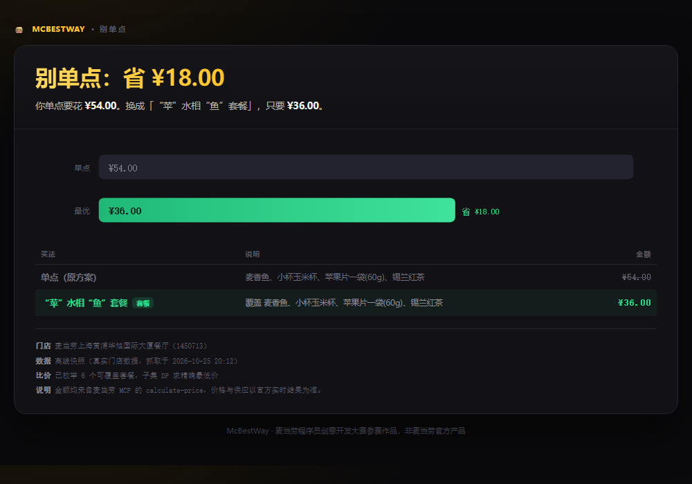

# 别单点 · McBestWay

> 用麦当劳 MCP 的真实菜单和真实报价，算出**最便宜的那种买法**。
> 很多时候它比你想的便宜 —— 因为你漏掉了套餐。



**一个真实结果**（上海某店，2026-10-25 抓取，可复现）：

| | |
|---|---|
| 想买 | 麦香鱼、小杯玉米杯、苹果片、锡兰红茶 |
| 单点 | ¥22.50 + ¥13.00 + ¥7.00 + ¥11.50 = **¥54.00** |
| 改买「"苹"水相"鱼"套餐」 | **¥36.00** |
| 结论 | 东西一模一样，**省 ¥18.00（33%）** |

这个数字不是估的：程序最后会用 `calculate-price` 对最终买法再报一次价做复核，本次复核结果同样是 ¥36.00。

---

## 30 秒跑起来（不需要 Token）

```bash
git clone <this-repo>
cd mcd-bestway
python3 mcbestway.py --offline --want "麦香鱼,小杯玉米杯,苹果片,锡兰红茶"
```

零依赖，只用 Python 标准库（3.8+）。运行后会在当前目录生成 `bestway-report.html`，浏览器打开就是上图那张报告。

`--offline` 用的是仓库里 `fixtures/store-snapshot.json` 的**真实门店快照**（123 个餐品、42 个套餐，来自麦当劳 MCP 实抓），所以即使没有 Token 也能完整看到真实结论。

---

## 接上真实门店（需要 MCP Token）

**1. 申请 Token**：打开 <https://open.mcd.cn/mcp> → 手机号登录 → 控制台 → 激活 → 复制

**2. 跑**：

```bash
export MCD_MCP_TOKEN="你的 Token"      # Windows: set MCD_MCP_TOKEN=...
python3 mcbestway.py --city 上海 --keyword 人民广场 --want "麦香鱼,小杯玉米杯,苹果片,锡兰红茶"
```

也可以直接指定门店编码：

```bash
python3 mcbestway.py --store 1450713 --want "巨无霸,中薯条,可乐"
```

**3. 看看它有哪些工具可用**：

```bash
python3 mcbestway.py --inspect
```

---

## 它到底在算什么

这不是"猜你爱吃什么"的推荐器，而是一个**精确的组合优化**：

```
你想要的 4 件商品  →  必须全部被覆盖
可用动作           →  单点某一件（覆盖 1 位）
                      买某个套餐（覆盖其中若干位，多余的是白得的）

目标：覆盖全部，花最少的钱
```

规模不大（单次最多 10 件），但组合会爆炸：43 个套餐 × 子集选择，人工算不过来。程序对 2^n 个状态做**记忆化 DP**，得到的是**精确最优解**，不是启发式。

### 三个让它跑得动、跑得准的细节

**① 一次调用拿全菜单的价格**

`query-meals` 只返回餐品编码（`code` + `tags`），不含名称和价格。逐个查详情要 123 次调用。这里用了一个取巧但完全合规的办法：**`calculate-price` 支持批量报价**，返回的 `productList[]` 里同时带 `productName` 和 `subtotal` —— 于是把全菜单塞进去分 5 批报价，就同时拿到了「名称 + 单价」。

> 实测单次上限是 30 件商品，超过会报 `600019 商品超过数量限制`，所以代码里按 25 件分批。

**② 套餐组成从 `query-meal-detail` 的默认选项里读**

套餐详情返回 `rounds[]`（第 1 轮选主食、第 2 轮选小食、第 3 轮选饮料……），每轮的 `choices[]` 里 `isDefault: 1` 的那一项就是套餐默认包含的商品。这才是"套餐里到底有什么"的权威答案，比按名字猜靠谱得多。

**③ 价格单位是「分」，不是「元」**

MCP 返回 `price: 3600` 表示 ¥36.00。整个流程内部用整数分做运算，只在输出时除以 100 —— 避免浮点误差把 ¥0.01 算丢。

---

## 用到的麦当劳 MCP 能力

| Tool | 在这里干什么 |
|---|---|
| `query-nearby-stores` | 按城市/关键词定位门店，拿 `storeCode` |
| `query-meals` | 拉门店在售餐品清单（分类 + 编码） |
| `calculate-price` | **核心**：批量报价拿全菜单单价；对每个候选买法真实试算；最后复核 |
| `query-meal-detail` | 解析每个套餐的默认组成 |

接入方式：Streamable HTTP，`POST https://mcp.mcd.cn`，请求头 `Authorization: Bearer <token>`。
配置示例见 [`mcp-config.example.json`](mcp-config.example.json)，调用细节与业务价值见 [`MCP_INTEGRATION.md`](MCP_INTEGRATION.md)。

---

## 目录结构

```
mcd-bestway/
├── mcbestway.py                  # 主程序（MCP 客户端 + 求解器 + 报告渲染，单文件）
├── fixtures/store-snapshot.json  # 真实门店快照，--offline 的数据源
├── examples/
│   ├── demo-report.html          # 生成的报告示例
│   └── report.png                # 报告截图
├── tests/test_solver.py          # 求解器与解析层的离线测试
├── SKILL.md                      # 在 Agent 里当技能用的说明
├── MCP_INTEGRATION.md            # MCP 集成说明（给评审看）
├── mcp-config.example.json       # 脱敏配置示例
├── CONTEST_DECLARATION.md        # 参赛声明（官方原文，未改动）
└── workbuddy.md                  # WorkBuddy 开发上下文
```

---

## 已验证 / 未覆盖

**已验证**（2026-10-25，真实门店 1450713）：
- 全菜单 123 个餐品成功定价
- 42 个套餐组成解析成功
- 主结论跑通，并用 `calculate-price` 复核一致
- 求解器有离线单测（`python3 -m pytest tests/` 或 `python3 tests/test_solver.py`）

**已知边界**，写出来免得误导：
- **只比"买法"，不比"券"**。券接口的券是绑定具体商品的固定价券，实测挂到普通商品上会报 `600012 促销规则不支持该商品`，所以本工具没有把券纳入求解。满减规则（`query-promotions`）目前只对企业团餐场景开放，且需要已保存的收货地址。
- **到店场景为主**（`orderType=1, beType=1`）。外送/得来速需要 `beCode`，代码已支持传参，但未在真实外送链路验证。
- **不替用户下单**。只输出"怎么买最省"，下单是用户的决定 —— `create-order` 工具存在，但故意没有接。
- 套餐的可替换选项（加 ¥1 换小食等）没有纳入组合搜索，用的是默认配置。

---

## 免责声明

本项目为**麦当劳程序员创意开发大赛参赛作品**，由个人独立开发，**非麦当劳官方产品**。输出仅供参考，餐品信息、价格与供应状态以麦当劳官方渠道的实时结果为准。

详见 [CONTEST_DECLARATION.md](CONTEST_DECLARATION.md)。
